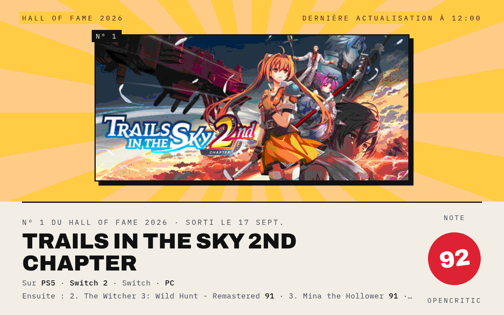
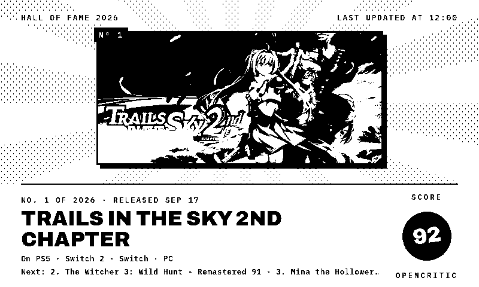
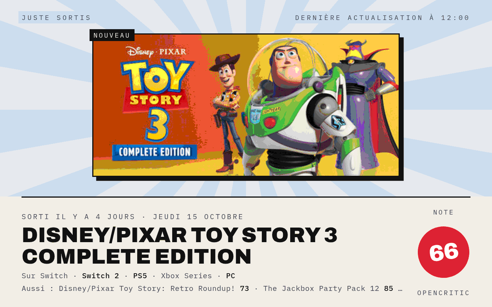
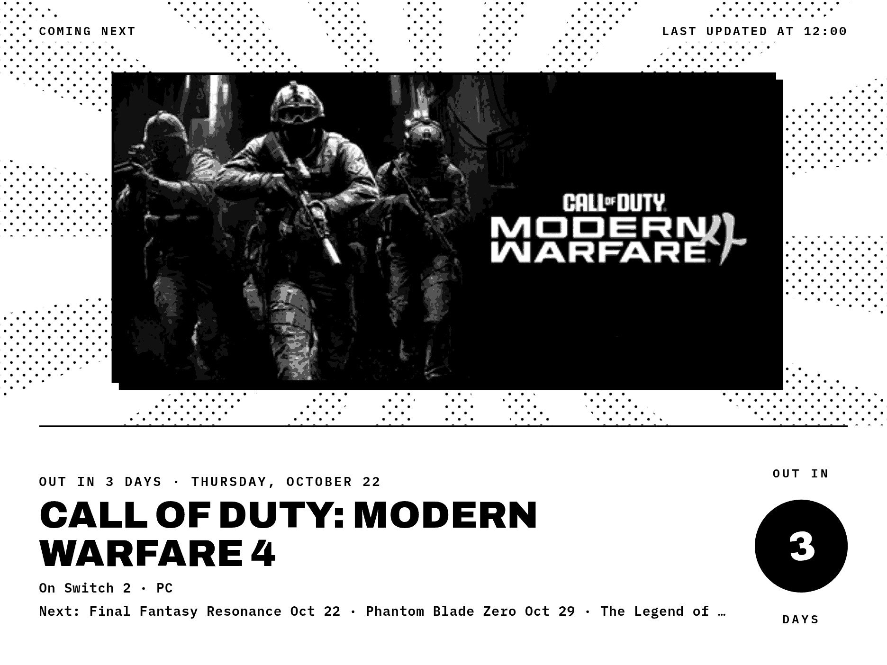
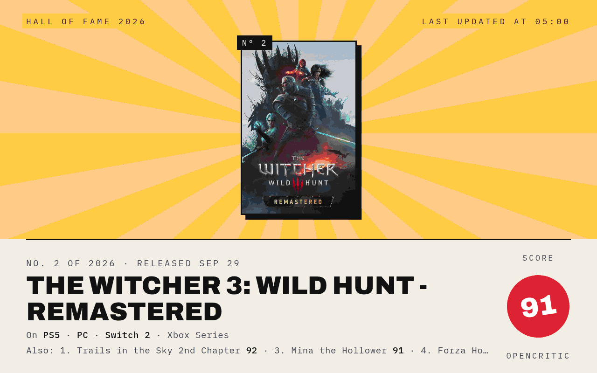
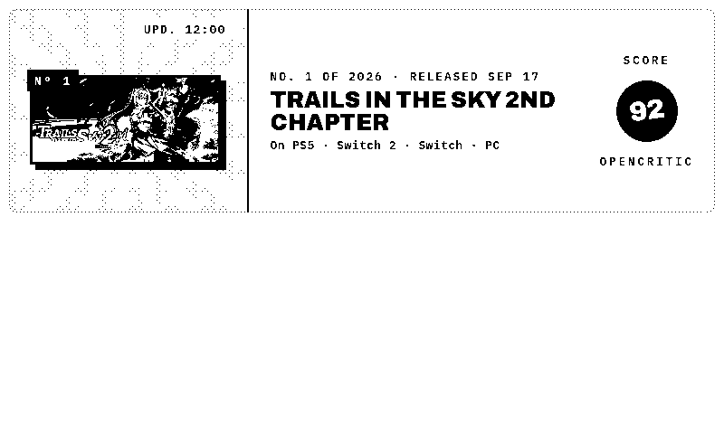
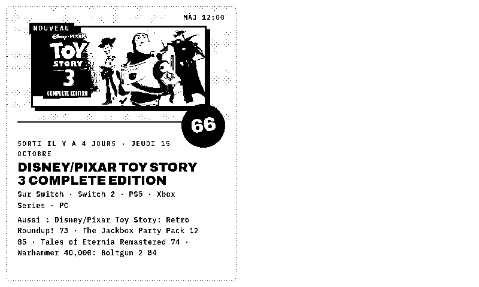
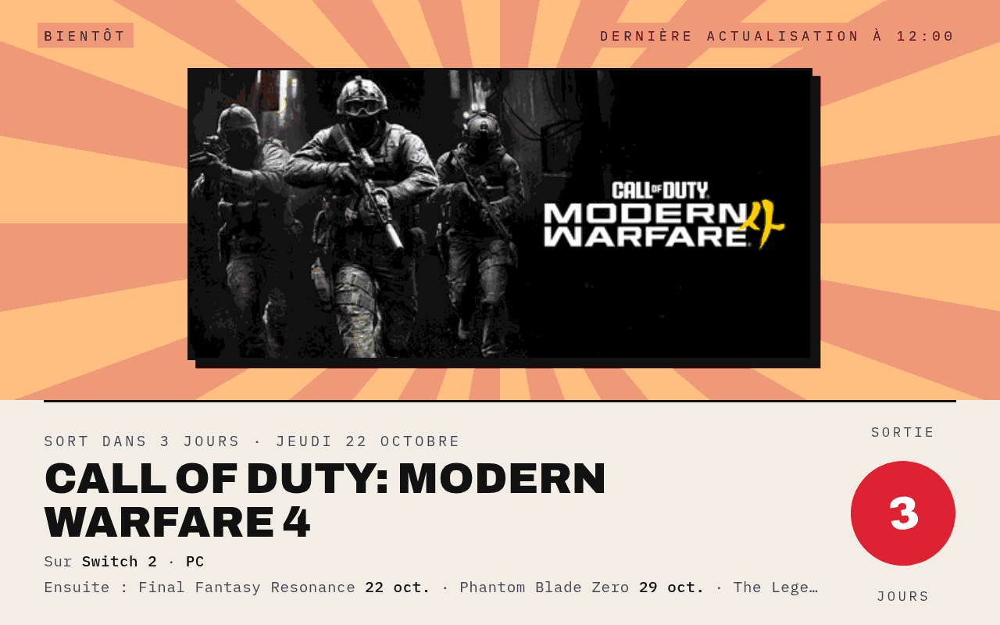
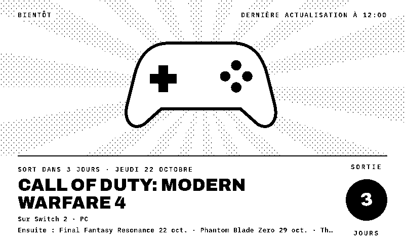
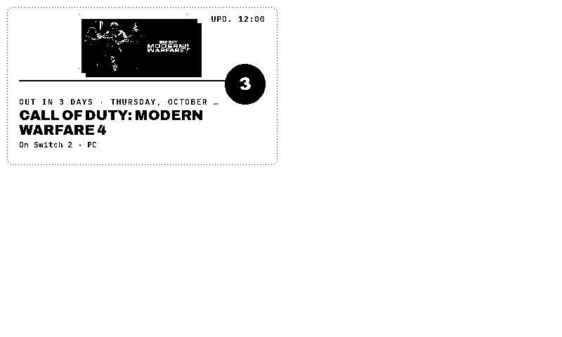

# GamePoster

**[English](#english) · [Français](#français)**

---

## English

*What to play next, drawn as a poster.*

A TRMNL plugin that puts one game on a poster: this year's best-rated games, the latest releases or the next ones, with its cover art, its OpenCritic score or a countdown to its release. It is part of the Poster suite with [FlightPoster](http://192.168.1.109:3000/Anthony/FlightPoster) and [WeatherPoster](http://192.168.1.109:3000/Anthony/WeatherPoster), and shares their look.

No server to install: the data comes from the feed of the [Game Watch](https://www.rapavy.cz/) plugin by Martin Rapavý, with ratings from [OpenCritic](https://opencritic.com).

### Features

- **E-ink and color**: a pure black & white style built for 1-bit screens (TRMNL OG, TRMNL X), and a color style for LCD screens
- **Every layout**: full screen, half horizontal, half vertical and quadrant (mashups)
- **Three sections**, each with its own sky color: the *Hall of Fame* of the year (gold), *Just released* (blue), *Coming next* (dusk)
- **Rotation**: every hour the poster moves to another section and another of its top three games, or stays on the section you pick
- **Score stamp**: the OpenCritic score, or the number of days before the release
- **Your platforms**: PlayStation 5, Xbox Series, Switch 2, Switch, PC; your platforms are shown in bold
- **English or French**
- Games without cover art get a gamepad illustration

### Screenshots

| | |
|---|---|
|  |  |
| E-ink · Hall of Fame | Color · just released |
|  |  |
| TRMNL X · coming next | Color · portrait cover art |
|  |  |
| Half horizontal | Half vertical |

### Installation

**TRMNL (usetrmnl.com)**: create a *Private Plugin* with the *Polling* strategy, then copy:
- `polling_url` from `recipe/src/settings.yml` into *Polling URL*;
- the `custom_fields` from `recipe/src/settings.yml` into *Custom fields* (YAML);
- `recipe/src/shared.liquid` into *Shared markup*, and each `recipe/src/<layout>.liquid` into the matching layout tab.

The `recipe/src/` folder follows the [trmnlp](https://github.com/usetrmnl/trmnlp) layout.

**LaraPaper / BYOS**: *Plugins → Import recipe*, pick `recipe/gameposter.zip` (built by `recipe_render.sh`, or zip the contents of `recipe/src/`), then fill in your settings.

### Settings

| Field | Purpose |
|---|---|
| Platforms | Games available on any of them; leave blank for all platforms |
| Poster | *Rotate* (every hour), or always the *Hall of Fame* #1, the latest release or the next release |
| Language | English or French |
| Style | E-ink (black & white) or Color |

### Development

| File | Purpose |
|---|---|
| `recipe_render.sh <folder>` | Zips the recipe, imports it into LaraPaper as "GamePoster (test)", renders every test case and copies the PNGs into `<folder>` |
| `recipe_test.php` | The test cases (section, rotation, layout, device, language, missing cover, errors) run inside LaraPaper |
| `test_payload.json` | A frozen Game Watch feed (October 19, 2026) used by the test cases |
| `update.php` | Copies the code of "GamePoster (test)" into the installed plugin, keeping its settings |
| `install.php` | First install: imports the recipe as "GamePoster" with Game Watch's platforms |

### Notes

- The screen is built with JavaScript at render time, so the renderer must run JavaScript.
- Cover art is loaded from OpenCritic at render time; on e-ink it is turned to grayscale and dithered by the renderer.
- In LaraPaper, the half and quadrant layouts render blank on the color (Echo Show) screen model, for every Poster plugin: they are tested on e-ink only.
- The feed is updated a few times a day: a refresh interval of 60 minutes keeps the rotation going without loading it needlessly.

---

## Français

*À quoi jouer ensuite, façon affiche.*

Un plugin TRMNL qui met un jeu à l'affiche : les jeux les mieux notés de l'année, les dernières sorties ou les prochaines, avec sa jaquette, sa note OpenCritic ou un compte à rebours avant sa sortie. Il fait partie de la suite Poster avec [FlightPoster](http://192.168.1.109:3000/Anthony/FlightPoster) et [WeatherPoster](http://192.168.1.109:3000/Anthony/WeatherPoster), dont il reprend le style.

Aucun serveur à installer : les données viennent du flux du plugin [Game Watch](https://www.rapavy.cz/) de Martin Rapavý, avec les notes d'[OpenCritic](https://opencritic.com).

### Fonctionnalités

- **E-ink et couleur** : un style noir et blanc pur pour les écrans 1 bit (TRMNL OG, TRMNL X) et un style couleur pour les écrans LCD
- **Tous les formats** : plein écran, demi horizontal, demi vertical et quart d'écran (mashups)
- **Trois rubriques**, chacune avec sa couleur de ciel : le *Hall of Fame* de l'année (doré), *Juste sortis* (bleu), *Bientôt* (crépuscule)
- **Rotation** : chaque heure, l'affiche passe à une autre rubrique et à un autre de ses trois premiers jeux, ou reste sur la rubrique choisie
- **Tampon** : la note OpenCritic, ou le nombre de jours avant la sortie
- **Vos plateformes** : PlayStation 5, Xbox Series, Switch 2, Switch, PC ; les vôtres sont en gras
- **Français ou anglais**
- Un jeu sans jaquette est illustré par une manette

### Captures

| | |
|---|---|
|  |  |
| Couleur · bientôt | E-ink · jeu sans jaquette |
|  |  |
| Quart d'écran | Demi vertical |

### Installation

**TRMNL (usetrmnl.com)** : créez un *Private Plugin* avec la stratégie *Polling*, puis copiez :
- `polling_url` de `recipe/src/settings.yml` dans *Polling URL* ;
- les `custom_fields` de `recipe/src/settings.yml` dans *Custom fields* (YAML) ;
- `recipe/src/shared.liquid` dans *Shared markup*, et chaque `recipe/src/<format>.liquid` dans l'onglet correspondant.

**LaraPaper / BYOS** : *Plugins → Import recipe*, choisissez `recipe/gameposter.zip` (créé par `recipe_render.sh`, ou zippez le contenu de `recipe/src/`), puis remplissez les réglages.

### Réglages

| Champ | Rôle |
|---|---|
| Plateformes | Les jeux disponibles sur au moins l'une d'elles ; vide pour toutes |
| Affiche | *Rotation* (chaque heure), ou toujours le nº 1 du *Hall of Fame*, la dernière sortie ou la prochaine |
| Langue | Français ou anglais |
| Style | E-ink (noir et blanc) ou Couleur |

### Notes

- L'écran est construit en JavaScript au moment du rendu : le moteur de rendu doit exécuter le JavaScript.
- Les jaquettes sont chargées depuis OpenCritic au moment du rendu ; en e-ink, elles passent en niveaux de gris, tramés par le moteur de rendu.
- Dans LaraPaper, les formats demi et quart d'écran sortent blancs sur le modèle d'écran couleur (Echo Show), pour tous les plugins Poster : ils ne sont testés qu'en e-ink.
- Le flux est mis à jour quelques fois par jour : un rafraîchissement toutes les 60 minutes suffit à faire tourner l'affiche.
